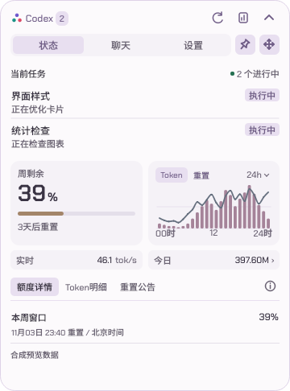
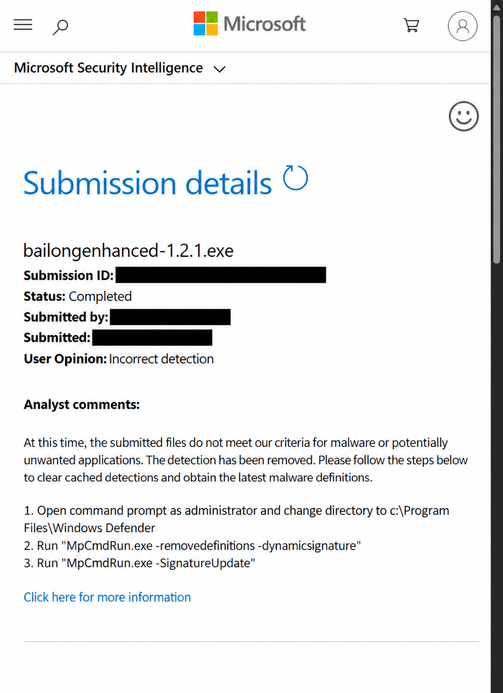

# Codex&GPT桌宠数据中心 | 你桌面的龙娘小助手

在桌面查看 Codex 任务状态、完成提醒、账户额度和 Token 用量，也可以让白龙陪你一起工作。支持仅卡片使用，人物动画按需下载。

**[Windows 首次安装](https://github.com/Wunsch2048/codex-bailong-desktop-pet/releases/download/v1.6.0/bailong-desktop-pet-1.6.0-setup.exe)** | **[程序更新](https://github.com/Wunsch2048/codex-bailong-desktop-pet/releases/latest)** | [Linux 预览版](#linux--niri--kde) | [macOS 社区版](#macos)

Windows 当前公开版 **v1.6.0**。在线安装器直接获取最新累计程序；已有用户可在“设置 → 维护 → 软件更新”升级，无需逐个安装旧补丁。升级保留设置、统计和已下载素材。


**[下载 macOS 社区版 1.6.0-mac.1](https://github.com/Kki1ds/codex-bailong-desktop-pet/releases/tag/v1.6.0-mac.1)**

## macOS 社区版

macOS 社区版由 [Kki1ds](https://github.com/Kki1ds) 在本 fork 维护，不是上游官方版本，上游作者没有 Mac，未在 Mac 上验证。界面、数据和动画与 Windows 版共用同一套代码，macOS 专属的部分（路径、Codex 发现、钥匙串、登录启动、窗口行为、构建）集中在独立模块中，Windows 行为不变。完整说明见 [docs/MACOS.md](docs/MACOS.md)。

| 项目 | macOS 社区版 |
| --- | --- |
| 当前版本 | 1.6.0-mac.1（预发布），基于上游 v1.6.0（18a9ba43） |
| 测试环境 | Apple Silicon，macOS 27.2，内置屏与外接显示器，ChatGPT.app 内置 Codex CLI |
| 不在范围内 | Intel Mac 未测试；不声明兼容所有 macOS 版本（最低设为 macOS 12） |

### 下载

| 文件 | 用法 |
| --- | --- |
| `BailongEnhanced-1.6.0-mac.1-macos-arm64.dmg` | 双击打开，把 `BailongEnhanced.app` 拖到旁边的“Applications”文件夹 |
| `BailongEnhanced-1.6.0-mac.1-macos-arm64.dmg.sha256` | 在下载目录运行 `shasum -a 256 -c BailongEnhanced-1.6.0-mac.1-macos-arm64.dmg.sha256` 校验 |

应用约 137 MB，自带 Python 与 Qt，无需安装其他软件，只需本机已安装 Codex 桌面端（ChatGPT.app）或 Codex CLI。安装包只含卡片，人物动画在 设置 → 角色与素材 中从上游 Release 下载，逐一校验后使用。

应用使用 ad-hoc 签名，未公证。首次打开时会提示无法验证开发者：在 Finder 中右键 .app 选择“打开”，或在 系统设置 → 隐私与安全性 中点“仍要打开”。

### 数据与隐私

设置和统计保存在 `~/Library/Application Support/BailongEnhanced`，源码运行和 .app 共用；升级时用新版替换旧版即可，设置和已下载的动画保留。桌宠不修改 Codex 的配置和登录凭据；闲聊密钥存放在登录钥匙串中，不写入文件。安装包不含账号、会话、个人设置或凭据。

### 已验证

1.6.0-mac.1 合入上游 1.3.0 至 1.6.0 的项目成本、自动价表、实时数字、主题、大卡片布局和四种走动方式，并修复任务完成后状态一直“忙碌”的问题。本机验收了 Chrome 原生全屏与视频全屏让位、多屏混合缩放、新提示浮窗与主题、真实 Codex 任务与提醒、登录启动与钥匙串、轻量动画和窗口模式走动。详情见 [1.6.0-mac.1 发布说明](https://github.com/Kki1ds/codex-bailong-desktop-pet/releases/tag/v1.6.0-mac.1) 和 [验证记录](docs/releases/v1.6.0-mac.1.md)；上一版 [1.2.1-mac.1](https://github.com/Kki1ds/codex-bailong-desktop-pet/releases/tag/v1.2.1-mac.1) 仍可下载。

### 已知限制

- 没有应用内更新，不要在 macOS 上使用上游的 Windows 安装器或补丁包；新版请到本仓库 Releases 下载。
- 不支持 WSL 连接来源（Windows 专属），设置中不显示该选项。
- 全屏让位用 Chrome 原生全屏与视频全屏实测；未用真实模型服务测试闲聊发送。
- 高清动画、Chrome 在前台时的窗口避让路线未在本版验收。
- 本版未重新测量性能，不沿用 1.2.1-mac.1 的 CPU 与内存数据。
- 其余限制见 [docs/MACOS.md](docs/MACOS.md#已知限制)。

### 维护范围

尽力维护，不承诺跟进每个上游版本：上游发布次版本或主版本（例如 1.1.0、2.0.0）时，同步代码、在 Mac 上实测并发布新的 macOS 包；补丁版本一般不单独跟进，影响使用的严重问题除外。macOS 相关问题请在 [本仓库 Issues](https://github.com/Kki1ds/codex-bailong-desktop-pet/issues) 反馈；Windows 版问题请到上游。

### 从源码运行

```bash
brew install python@3.12
/opt/homebrew/opt/python@3.12/bin/python3.12 -m venv .venv
.venv/bin/python -m pip install -r requirements-enhanced.txt
.venv/bin/python app/enhanced.py
```

本机构建 .app：`.venv/bin/python build_macos.py --cards-only`，加 `--dmg` 同时生成安装镜像，详见 [docs/MACOS.md](docs/MACOS.md#构建-app)。

## 最近更新

### v1.6.0

- **数字更及时**：今日 Token 随日志增量更新，今日与实时速率加入数字翻动，排版更紧凑。
- **价格自动更新**：API 单价和官方 Credits 价表可自动更新，历史价格与手动设置保留。
- **额度更好读**：混用模型也可查看黄色参考差异，图表位置上移。
- **提醒更准确**：会话继续工作后撤销旧完成提醒，避免内部记录被误当成额外会话。
- **切换更顺畅**：统一大卡片默认高度，改善首次展开、筛选栏和设置分区切换；修复页面复位、日报背景闪块、多处悬停闪烁及实时窗口收起。

[查看 v1.6.0 完整更新与下载](https://github.com/Wunsch2048/codex-bailong-desktop-pet/releases/tag/v1.6.0)

## 主要功能

- **任务联动**：查看思考、编辑、命令执行等状态，接收完成提醒，点击会话名跳转。
- **额度与统计**：额度环、重置倒计时、Token 柱线图、实时速率、日报和项目成本估算。
- **桌宠与卡片**：胶囊、正常卡片和大卡片切换；35 个动作、贴边收纳、四种走动方式及八套主题。
- **日常使用**：托盘找回、全屏让位、集成闲聊、连接诊断、应用内更新和版本回退。

<details>
<summary>查看界面与动效</summary>



| 胶囊展开 | 日报展开与收回 |
| --- | --- |
|  |  |

配图使用合成示例数据，历史界面与当前版本可能略有区别。

</details>

[完整功能与使用说明](docs/使用说明.md) | [全部版本记录](docs/releases)

## 安装与连接

1. 运行顶部的 Windows 在线安装器，无需 Python 或管理员权限。
2. 在本机安装并登录 Codex，发送一次消息，桌宠会自动发现本机数据。
3. 需要人物时，在设置的素材页下载轻量或高清动画；只用卡片可以跳过。
4. 没有数据时，打开“设置 → Codex → 检测连接与额度”。

仅支持 Windows x64。离线安装、程序位置和数据目录见[快速部署](docs/快速部署说明.txt)；WSL 用户见 [WSL 接入](docs/WSL.md)。闲聊需要自行配置模型服务。

Token 与速率统计覆盖本机可读取的记录；项目成本是 API 等价估算，不是订阅实际扣费。更多口径见[使用说明](docs/使用说明.md#数据和能力的范围)。

## 其他平台

### Linux / niri / KDE

Linux 适配源码已合入主分支，预览包由 [helantianshen](https://github.com/helantianshen/codex-bailong-desktop-pet#linux--niri--kde) 社区维护。当前预览 **v1.4.2-linux-preview.5** 面向 CachyOS/Arch x86_64，要求 **glibc ≥ 2.44**；支持 niri 原生 Wayland 与 KDE Plasma X11/XWayland，不代表覆盖所有发行版。

[下载预览包](https://github.com/helantianshen/codex-bailong-desktop-pet/releases/tag/v1.4.2-linux-preview.5) | [Linux 运行说明](docs/LINUX.md) | [KDE 说明](docs/KDE.md) | [包体与限制](docs/LINUX_PACKAGE.md)

### macOS

[Kki1ds 社区版](https://github.com/Kki1ds/codex-bailong-desktop-pet)提供 Apple Silicon DMG，未公证、无应用内更新。[下载与安装说明](https://github.com/Kki1ds/codex-bailong-desktop-pet/releases)以维护者仓库为准。

社区包由对应作者测试和发布，平台问题请前往对应仓库反馈；Windows 安装器和程序补丁不适用于 Linux 或 macOS。

## 安全反馈

微软已完成对提交的 **1.2.1 样本**的复核并移除该样本检测。结论限于该文件；其他版本、文件及卡巴斯基反馈仍需分别核查。[详细进展与处理建议](docs/安全反馈.md)

<details>
<summary>微软复核结果（已脱敏）</summary>



用户提供的截图已脱敏并整理版面，邮箱、提交编号和精确提交时间已遮挡。判定文字已对照原图核对。

</details>

## 文档与反馈

[使用说明](docs/使用说明.md) | [开发与构建](docs/DEVELOPMENT.md) | [维护规范](docs/维护规范验证入口.md) | [迭代历史](docs/迭代历史.txt) | [提交问题](https://github.com/Wunsch2048/codex-bailong-desktop-pet/issues/new/choose)

反馈请附版本、系统缩放和复现步骤，并去掉截图、日志中的私密信息。

## 来源与许可

基于 [jingh12312-rgb/bailong-desktop-pet](https://github.com/jingh12312-rgb/bailong-desktop-pet) 改造。角色形象、原有动作及基础程序来自原项目，增强内容见版本记录。

本项目未统一采用 MIT 许可。发布者获得的公开再分发授权不自动授予访问者商业使用或再分发权；详见 [NOTICE](NOTICE.md)、[原素材说明](docs/upstream/ASSETS.md)及各依赖许可证。

本项目为独立第三方程序，与 OpenAI、Codex 官方无隶属关系。
